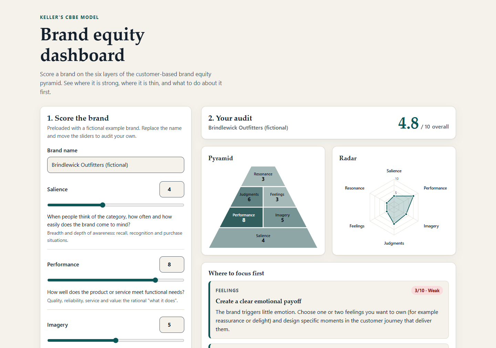
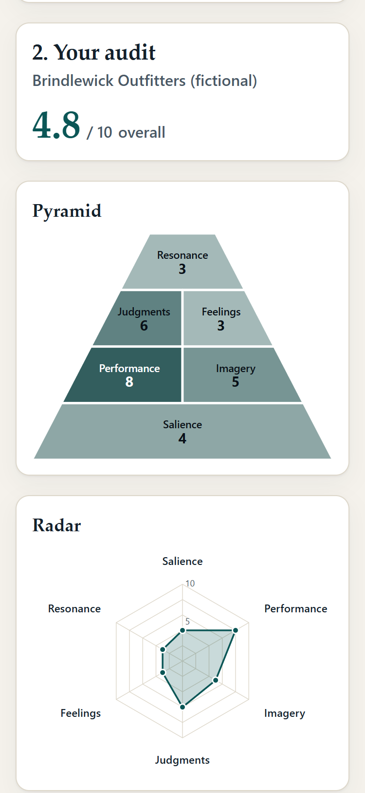

# Brand Equity Dashboard

A small static web app for auditing a brand against Keller's customer-based brand equity (CBBE) pyramid. Score six layers with sliders, see a pyramid and a radar chart, read plain-English recommendations for the weakest layers, and export the audit as markdown.

It ships preloaded with **Brindlewick Outfitters**, a fictional outdoor-gear brand invented for this demo. It is not a real company.



It also works at phone width (375px). The charts and results stack into a single column:



## The CBBE model in three sentences

Keller's CBBE model says a brand's strength lives in the minds of its customers and builds up a pyramid in four steps: salience (do they know it?), then performance and imagery (what does it do, and what does it stand for?), then judgments and feelings (what do they think and feel about it?), and finally resonance (how loyal and engaged are they?). Each layer depends on the one beneath it, so a weak foundation limits everything above. Source: Keller, K. L. (1993). Conceptualizing, measuring, and managing customer-based brand equity. *Journal of Marketing, 57*(1), 1-22.

## Features

- Six 0-10 inputs (slider plus number field, kept in sync) and an editable brand name
- Pyramid visualisation (darker means stronger, with the score printed in each block) and a radar chart
- Rule-based recommendations for up to three weakest layers below 7, foundation-first on ties
- Imbalance detection (for example high awareness with weak substance, or rational without emotional)
- Markdown export: download a file or copy to the clipboard
- Responsive from 375px to wide desktop, light and dark themes, keyboard accessible

## Run it

Requires Node 20+.

```bash
npm install
npm run dev          # local dev server
npm test             # unit tests
npm run test:coverage
npm run lint
npm run typecheck
npm run build        # outputs dist/, a static site you can host anywhere
npm run preview      # serve the production build
```

## Project layout

```
src/core/cbbe.ts       pure scoring, bands, recommendations, imbalances, markdown export
src/core/geometry.ts   pure radar/pyramid geometry and colour/contrast helpers
src/core/example.ts    the fictional example brand
src/ui/                DOM rendering and form wiring (thin, no business logic)
src/main.ts            entry point
```

## Decisions

- **No framework.** The UI is one screen of state; Vite and TypeScript with small render functions keeps the bundle around 15 kB and the code easy to read.
- **Pure core, thin UI.** All scoring, copy selection and geometry live in `src/core` with no DOM access, written test-first with vitest. Coverage is enforced at 80% (lines, functions, branches, statements) for that folder.
- **Rules, not AI.** Recommendations are deterministic: layers under 7 are ranked lowest first, ties go to the lower pyramid layer, and wording switches between "build" (below 5) and "sharpen" (5 to 6). The same input always gives the same audit.
- **Accessible by construction.** Every control has a label, charts carry a text description of every score, score is never conveyed by colour alone, and block text colour is chosen by computed WCAG contrast (tested to be at least 4.5:1).
- **Strict TypeScript.** `strict` plus `noUncheckedIndexedAccess`, `type` over `interface`, no `enum` (const objects with `as const`), no `any`.
- **Self-assessed scores.** The tool structures a conversation; it does not replace consumer research.

## Licence

MIT, see [LICENSE](LICENSE).
